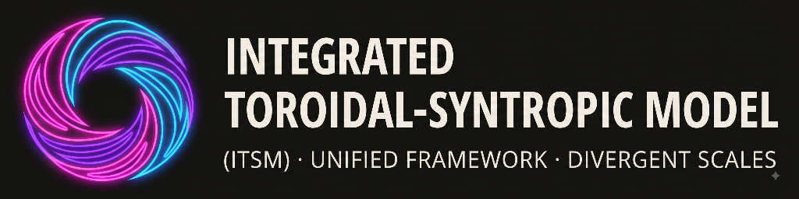

  

# 🌌 Integrated Toroidal-Syntropic Model (ITSM)

**v12 core-recovery branch — evidence-controlled research programme**

🌍 **Website:** [itsm-cosmology.com](https://itsm-cosmology.com) |
📧 **Contact:** [brendon.boyd@itsm-cosmology.org](mailto:brendon.boyd@itsm-cosmology.org)

## 📖 The proposed physical universe

ITSM asks whether the vacuum itself could be an active physical medium: a
finite-density condensate, or **plenum**, with density, phase, excitations and
circulation. In this research proposal, matter interacts with that medium,
and its stress and response may have gravitational consequences. The task is
to derive those consequences from a specified action and test them across
local gravity, galaxies and cosmology.

The proposed spatial topology is a compact **three-torus, $T^3$**. Its
fundamental domain is a three-dimensional cell with opposite faces
identified, so fields obey periodic boundary conditions. This describes
global connectivity; it does not determine a physical size, an acceleration
scale or a force coefficient. The plenum's local excitations, global winding
sectors and topology-dependent stresses are distinct physical ingredients.

The observable matter–plenum subsystem may also exchange energy and momentum
with a **reservoir**. The reservoir belongs inside the complete conservation
accounting. Its interaction and thermodynamics must be specified before
claims about driven expansion or persistent anisotropy can follow. Together,
these ingredients define a candidate physical universe whose mechanisms and
predictions are still being reconstructed.

## 🚦 Reality check

> **Established within stated scopes:** the recovery records a sector architecture, checked conditional action/current calculations and bounded negative results, with individual claims classified in the [live claim ledger](Theory/Core/ITSM_Claim_Migration_Ledger.csv). **Open:** complete physical stability, a controlled EFT domain, healthy GR recovery, matter matching and calibrated observable predictions. **Blocked:** MAT-001 remains `BLOCKED`, `K_Q` is `NOT_DERIVED`, `V` is `NOT_COMPUTED`, UVIR-003 remains `IN_PROGRESS`, and canonical Master Tests 1–3 remain `HOLD_SUBSTANTIVE`. **Rejected or withdrawn:** the historical geometric-coefficient, parameter-free Hubble and validation packages listed in [Historical claims and deprecations](docs/history/README.md) supply no live scientific support. Rule-9 review is `DEFERRED`; supported provisional research may continue, while canonical promotion and publication readiness retain their scientific and review requirements.

## 🔬 Five physical pillars and their relationships

These are the five pillars in the [Core Identity Briefing](Theory/Core/ITSM_CORE_IDENTITY_BRIEFING.md).
They identify the physical questions; their connections still require
derivation or matching.

| Pillar | Physical content | Connection to the other pillars |
|---|---|---|
| **Finite-density condensate** | A declared nonzero background with order parameter $\Phi=(\rho/\sqrt{2})e^{i\Theta}$. The vacuum-medium premise is a **Conditional** postulate. | Supplies amplitude and phase variables for local fluctuations, circulation and interactions. It does not by itself determine the force sector. |
| **Low-energy excitations** | Phonons and amplitude modes about a specified condensate background; the target IR description must be derived and matched. | Connects the microscopic medium to local response. The selected architecture keeps the condensate and force mediator distinct while their microscopic matching remains open. |
| **Global circulation and winding** | Quantized phase winding and vortex sectors on compact topology. | Uses the condensate phase and global boundary conditions. Macroscopic circulation matching remains open; winding alone does not fix a galactic acceleration coefficient. |
| **Compact boundary conditions** | Periodic spatial $T^3$ topology, with declared lengths and shape moduli. | Restricts modes and winding sectors and can produce shape-dependent stress. A torus does not automatically select its physical size or a persistent expansion ratio. |
| **Reservoir / syntropic exchange** | An open observable subsystem with an explicitly modelled compensating reservoir. Microscopic reservoir closure remains **Open**. | May exchange with the plenum, but matter–plenum transfer, reservoir throughput and condensate-charge transfer remain distinct unless the action relates them. Total stress-energy conservation is required. |

The condensate supplies the local field variables; topology supplies their
global boundary conditions; excitations and winding describe different
sectors of their response. Reservoir interactions add an exchange problem.
The [Core Architecture](Theory/Core/ITSM_Core_Architecture.md) specifies these
relationships and the separate metric, preferred-frame, force and matter
sectors. Connecting them into one predictive theory remains the research task.

## 🧭 Live gate dashboard

Use the [Active Research & Gate Dashboard](active_research.md) for canonical
gate authority, the [execution queue](Theory/Core/ITSM_Recovery_Execution_Queue.md)
for dated research continuations, and the
[deferred-review register](Theory/Verification/ITSM_RULE9_DEFERRED_REVIEW_REGISTER.md)
for their scope and inherited review dependencies. This table summarizes
those boundaries; sector snapshots retain their owning dates.

| Gate / sector | Status | Meaning for the proposed physics |
|---|---|---|
| **Core identity** | `CANONICAL; IDENTITY HELD` | The physical proposition is retained; its adoption does not validate its postulates or close a mechanism. |
| **MAT-001** | `BLOCKED` | The invariant matter-to-physical-mode response remains unmatched: `K_Q=NOT_DERIVED`, `V=NOT_COMPUTED`. |
| **UVIR-003** | `IN_PROGRESS` | Tier-1 stability, matching and physical cutoff obligations remain incomplete. Stage 4A remains `CLOSED`. |
| **Master Tests 1–3 / R4C1** | `PROVISIONAL CONTINUATION; HOLD_SUBSTANTIVE` | The registered linear prepared-dust calculation now has certified finite-mode error control. Physical viability, a controlled EFT window, healthy GR, weak-field closure and identifying coefficient matching remain open. |
| **TOP-X4 / KK-001** | `BOUNDED LOCAL/FINITE-ORDER + THEOREM-BACKED SCALAR STATE; STRESS HOLD` | Separate queued lane; `physics_pass=false`. Spinor-state, gravity/ghost, parity, determinant, stress and physical-Hessian obligations remain open. |
| **BBN-001** | `CONTROL_ONLY / BLOCKED_UPSTREAM_BACKGROUND` | Table/network controls do not supply the action-derived early plenum, physical temperature/unit map, currents or gravitational response. |
| **TOP-001 / CBR-002** | `HOLD` | Free-field and instantaneous-closure controls do not establish a persistent driven ITSM solution or publication clearance. |
| **RES-001** | `OPEN_SCAFFOLD_ONLY` | Microscopic reservoir closure remains open. The single-mode GKSL baseline is a control; the separate R4C1 candidate retains its own conditional scope. |
| **VOR-001** | `OPEN_SCAFFOLD_ONLY` | A phase/winding specification supplies no physical resonance prediction or gate closure. |
| **Papers / publication** | `PUBLICATION HOLD` | Local calculations and rebuilt drafts do not confer publication readiness. |
| **Rule 9 evidence** | `DEFERRED; Rule9_cleared=false` | Review scheduling permits supported provisional work; substantive failures still hold affected uses. |

The [Master Test Programme](Theory/Core/ITSM_MASTER_TEST_PROGRAMME_2026-09-24.md)
orders the research, and the [Master Research Plan](Theory/Core/ITSM_Master_Research_Plan.md)
defines the authority and claim boundaries. Script check counts and hash
matches establish only their stated calculation or artifact scope.

## 🧪 Current research checkpoint — 13 October 2026

The [checkpoint and exact-byte evidence map](Theory/Verification/ITSM_RESEARCH_CHECKPOINT_2026-10-13.md)
collect the previously uncommitted research and paper-preparation work.
The physical progress and its limits are separate:

- **Bounded dust calculation complete:** the [Stage-1 acceptance report](Theory/Gates/RES-001/RES001_R4C1_G3N5_DUST_STAGE1_ACCEPTANCE_REPORT_2026-10-12.md)
  consolidates the evolving slow/complement split, finite-wavenumber correction,
  retained fast forcing, operator-order result and certified error control for
  the five registered modes on $0\leq t\leq0.05$. This is the linear rotating
  B1 prepared-data calculation, not physical/canonical dust closure.
- **Physical-domain decision still open:** the [same-action GR-family survey](Theory/Gates/RES-001/RES001_R4C1_GR_FAMILY_SURVEY_REPORT_2026-10-11.md)
  and subsequent coupled response work retain all three diagnostic families.
  The [quadratic fixed-charge comparison](Theory/Gates/RES-001/RES001_R4C1_FIXED_CHARGE_RETARDED_V3_REPORT_2026-10-13.md)
  does not remove the registered cubic timing warning. No family has physical
  GO; complete physical energy/constraint admission, nonlinear error control,
  a frequency/momentum window and justified GR recovery remain required.
- **Matching mechanisms screened, not identified:** [RM1](Theory/Gates/MAT-001/MAT001_RM1_RADIAL_MASS_SCREEN_REPORT_2026-10-13.md)
  rejects the tested radial portal as a nonzero soft static phase source;
  [ST1](Theory/Gates/MAT-001/MAT001_ST1_INDUCED_SCALE_SCREEN_REPORT_2026-10-13.md)
  supplies a parameterized static source with an unfixed physical kinetic ratio;
  [ST2](Theory/Gates/MAT-001/MAT001_ST2_HEAVY_THRESHOLD_SCREEN_REPORT_2026-10-13.md)
  computes a finite heavy-field threshold but leaves renormalized inputs and
  the physical background open. These separate controls do not select a new
  canonical parent or determine numerical $K_Q$, $V$, $C_\chi$ or $a_0$.

Stage 2 remains incomplete under the approved unchanged-action continuation;
Stage 3 has not been entered. The earlier negative homogeneous canonical
direction and different-ensemble positive control remain unchanged in the
[11 October report](Theory/Gates/RES-001/RES001_R4C1_G3N5_MEAN_MODE_ENERGY_REPORT_2026-10-11.md).
The [dated recovery evidence guide](docs/ITSM_RECOVERY_EVIDENCE_GUIDE.md) preserves
that snapshot rather than replacing its failures with later successes.

P1/P2 `v0.2.0-rc3`, Thermodynamics `v0.7.1-conditional-draft` and R4C1
`v0.1.1-conditional-draft` are retained with their preparation/review records.
The [local P1/P2 critique](papers/ReleasePackages/2026-10-09/P1_P2_LOCAL_REFEREE_REVIEW_AND_GROK_RECONCILIATION_2026-10-09.md)
still requires targeted revisions and author decisions. These are drafts and
release candidates, not independent peer-review clearance or publication readiness.

## 📚 Governance and methodology

The [Governance and Methodology guide](Governance/README.md) explains claim
classification, reproducibility, deferred review, dependency inheritance and
publication boundaries. It documents how the research is assessed, with
links to the binding instructions and scientific authorities.

A failed physical candidate can still yield a useful negative result. The
quality of the research process and the physical truth of its candidate
model require their own evidence.

## 🗂️ Historical claims and deprecations

[Historical claims and deprecations](docs/history/README.md) explains
which earlier claim formulations were withdrawn and which underlying
questions remain open. That archive links the preserved pre-v12 README and
the governing claim dispositions. The wider private historical corpus
retains its existing repository exclusion. Historical manuscripts provide provenance;
current scientific claims belong to the live authority documents above.

## 📂 Repository map

| Location | Role |
|---|---|
| Core theory — `Theory/Core/` ([browse](Theory/Core/)) | Physical identity, sector architecture, master plans and claim ledger |
| Scientific gates — `Theory/Gates/` ([browse](Theory/Gates/)) | Owning scientific reports, contracts and decision records |
| Analysis and diagnostics — `Analysis/` ([browse](Analysis/)) | Symbolic and numerical diagnostics within each report's stated scope |
| Governance and methodology — `Governance/` ([browse](Governance/)) | Reader guide to the research methodology and binding governance |
| Recovery manuscript — `Manuscript/CoreRecovery/` ([browse](Manuscript/CoreRecovery/)) | Working recovery manuscript and immutable versioned releases |
| Paper programme — `papers/` ([browse](papers/)) | Selective paper programme and its publication requirements |
| History and deprecations — `docs/history/` ([browse](docs/history/)) | Preserved pre-v12 landing-page text and deprecations |
| [Recovery Branch Guide](RECOVERY_BRANCH_README.md) | Detailed branch orientation and dependency chain |
| [Recovery evidence guide](docs/ITSM_RECOVERY_EVIDENCE_GUIDE.md) | Retained 11 October landing-page evidence and detailed report links |
